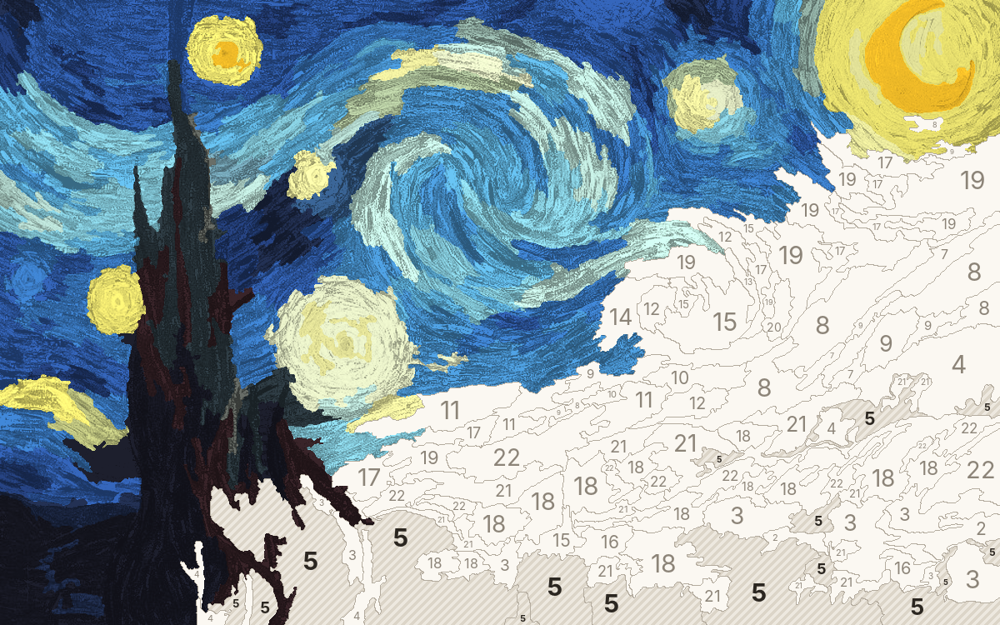

# Atelier des Maîtres

Application Android (Kotlin, Jetpack Compose) pour repeindre des chefs-d'œuvre du domaine public, zone par zone.



## Ce que fait l'application

- **Galerie** de 7 toiles : Van Gogh (La Nuit étoilée, Champ de blé avec cyprès, Le Café de nuit, Maisons et personnage), Hokusai (La Grande Vague), Turner (Le Naufrage du Minotaure), Munch (Le Cri). Les toiles pas encore commencées sont en sépia, et le pourcentage d'avancement s'affiche sous chaque cadre.
- **Importer une œuvre** : n'importe quelle image du téléphone (un Monet téléchargé sur Wikimedia Commons, une photo…) est découpée en zones sur l'appareil, en environ une seconde.
- **Trois niveaux** par toile : Facile (≈ 100 zones, 14 couleurs), Normal (≈ 280 zones, 22 couleurs), Expert (≈ 700 zones, 32 couleurs). Chaque niveau garde sa propre progression.
- **Peindre** : on choisit une couleur numérotée dans la palette, puis on touche les zones. Les zones de la couleur active sont hachurées pour les repérer.
- **Choisir sa couleur** : un appui long sur une zone ouvre le nuancier (couleur du maître, palette de la toile, ou n'importe quelle couleur via teinte, saturation et luminosité). On peut aussi peindre librement.
- **La matière du tableau** : une zone peinte reprend les coups de pinceau de l'original, modulés sous la couleur posée.
- Zoom à deux doigts, déplacement, numéros toujours nets qui apparaissent quand on s'approche, bouton « trouver une zone », annuler / rétablir, gomme, œil à maintenir pour comparer avec l'original, sauvegarde automatique, écran de fin avec l'histoire de l'œuvre.
- **En anglais et en français**, selon la langue du téléphone (ou celle choisie pour l'application dans les paramètres d'Android 13+).
- **Partager sa toile** (menu ⋮ ou écran de fin) : l'image peinte, encadrée d'une marge de papier, part vers n'importe quelle application.

## Publier sur le Play Store

Tout est préparé dans [docs/play-store](docs/play-store/README.md), et l'[audit de publication](docs/audit-publication.md) liste ce qui reste à faire.

Les politiques de confidentialité ([français](docs/confidentialite.md), [anglais](docs/privacy.md)) deviennent des pages web en activant GitHub Pages une fois : *Settings › Pages › Build and deployment › Deploy from a branch*, branche `main`, dossier `/docs`. Elles sont alors à l'adresse `https://loucoumepixel.github.io/atelier-des-maitres/confidentialite.html` (et `privacy.html`).

## Installer l'application

**Le plus simple, depuis le téléphone** : ouvrir la [dernière Release](https://github.com/loucoumepixel/atelier-des-maitres/releases/latest), télécharger `atelier-des-maitres.apk` et l'ouvrir en autorisant l'installation d'applications de sources inconnues. Chaque version de `main` y est publiée automatiquement.

> Une application installée depuis le Play Store et celle des Releases ne sont pas signées par la même clé (Google re-signe l'application du store) : pour passer de l'une à l'autre, il faut désinstaller d'abord.

**Avec Android Studio** (gratuit, Windows, Mac ou Linux) :
1. Ouvrir Android Studio, puis *File › Open* et choisir ce dossier.
2. Laisser Android Studio télécharger ce qu'il demande (la première synchronisation prend quelques minutes).
3. Brancher le téléphone en USB avec le *débogage USB* activé (Paramètres › À propos › appuyer 7 fois sur « Numéro de build », puis Options pour les développeurs › Débogage USB).
4. Cliquer sur ▶ *Run*.

**En ligne de commande** (JDK 17 et SDK Android installés) : `./gradlew :app:assembleRelease`, puis `adb install app/build/outputs/apk/release/app-release.apk`.

Android 9 ou plus récent.

## Architecture

```
core/   Kotlin pur, sans Android : tout ce qui est algorithmique, testé sur JVM
  Segmenter        image → zones (k-means++ en Lab, filtre majoritaire, fusion des petites zones,
                   transformée de distance pour placer les numéros)
  PaintByNumber    la toile découpée, en tableaux primitifs + index zone → pixels
  PaintingSession  ce qui est peint, annuler / rétablir, compteurs par couleur
  PbnCodec         format binaire compact (étiquettes compressées par plages)
app/    Android, Jetpack Compose, Material 3
  data/            catalogue, imports, cache du découpage, sauvegarde atomique de la progression
  ui/gallery/      galerie en grille décalée, choix du niveau
  ui/studio/       atelier : CanvasRenderer (bitmap mis à jour par rectangles),
                   CanvasCamera (zoom / déplacement animés), PaintCanvas, palette, nuancier
```

Quelques choix :
- **Le découpage se fait sur l'appareil** et non à l'avance : une seule implémentation sert aux toiles fournies et aux images importées. Il est mis en cache après le premier calcul.
- **Lab plutôt que RVB** : les zones suivent la perception humaine des couleurs.
- **Les numéros sont dessinés à l'échelle de l'écran**, pas dans l'image : ils restent nets à tous les zooms.
- **Pas de double tap** : il retarderait chaque touche de pinceau de 300 ms.
- **Aucune dépendance superflue** : pas de bibliothèque d'images, de navigation ni d'injection ; tout tient dans Compose, les coroutines et le SDK.

## Tests

`./gradlew :core:test` lance les 16 tests du moteur : découpage, fusion des petites zones, résistance au bruit, placement des numéros, déterminisme, annuler / rétablir, sérialisation.

## Les œuvres

Toutes les œuvres fournies sont dans le domaine public (artistes morts depuis plus de 70 ans). Pour ajouter une toile au catalogue : déposer le JPEG dans `app/src/main/assets/paintings/` et ajouter une entrée dans `MasterCatalog` (`data/Painting.kt`).
